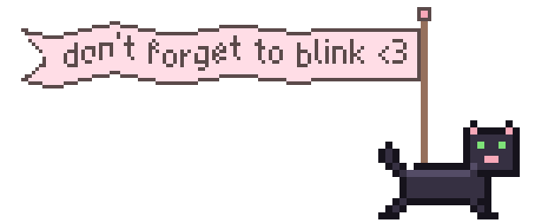
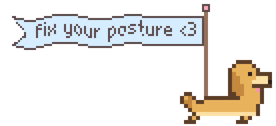
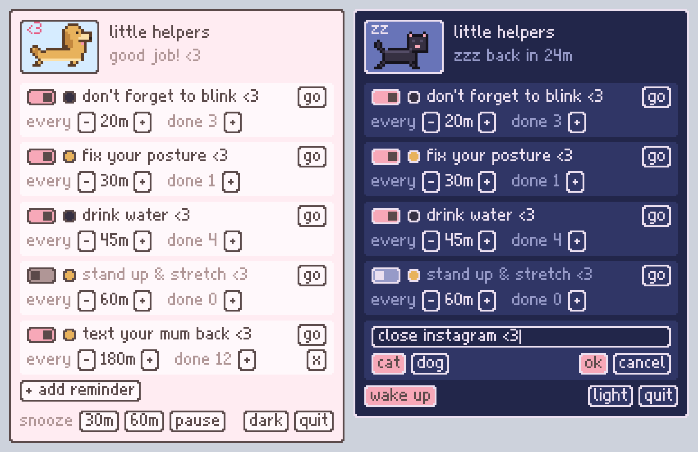

# Little Helpers 🐾

Pixel pets that run across your Mac with gentle reminders <3

A black cat and a golden dog sprint along the bottom of your screen carrying little flags:
they remind you to blink, drink water, fix your posture and stretch. Clicks pass straight
through them, so they never get in your way.

**New in 1.1: task notes.** Plan tomorrow the night before ("8:15 take charger",
"revise for the maths test"), and at that exact time a pet pops up in the corner holding
your list. It waits until you click it, then cheers and leaves.

  
  

## Features

### Task notes (new in 1.1)

- open the paw menu → **tasks**, pick **today** or **tomorrow**, and add tasks with a time
- quick add: just type `8:15 take charger` and the time fills itself in
- tasks can happen once, every day, on weekdays, or on the days you choose
- at the time, the **cat** (morning) or the **dog** (afternoon and evening) pops up with a sparkle,
  holding a note with everything due at that time
- click the pet when you're done and it celebrates; **later** brings the note back in 10 minutes
- ignored notes get a little hop every 2 minutes; notes missed while your Mac was asleep show up when it wakes
- choose whether notes appear in the top-left or top-right corner

### Running reminders

- 🐈‍⬛ **cat:** "don't forget to blink" (every 20 min) and "drink water" (every 45 min)
- 🐕 **dog:** "fix your posture" (every 30 min) and "stand up & stretch" (every 60 min)
- a cute pixel menu in your menu bar (click the paw):
  - turn each reminder on or off and change how often it runs
  - write your own reminders and choose who carries them
  - send any pet across the screen right now
  - count what you did today; your pet cheers for you
  - snooze for 30 or 60 minutes, or pause; your pet falls asleep
  - light and dark mode
  - choose where the pets run: the bottom, the middle, or any height you click
- no Dock icon, and no image files: every pixel is drawn from code

## Download

1. Go to [**Releases**](../../releases/latest) and download `LittleHelpers-mac.zip`.
2. Double-click the zip, then drag **Little Helpers** into your **Applications** folder.
3. Open it. Because the app is free and not registered with Apple, macOS will warn you
   that it cannot check it:
   - click **Done** (or **OK**) on the warning,
   - open **System Settings → Privacy & Security**,
   - scroll down and click **Open Anyway** next to "Little Helpers", then confirm.

   You only need to do this once.
4. Look for the 🐾 paw in your menu bar.

Requires macOS 11 (Big Sur) or later.

**To uninstall:** click the paw → **quit**, then move the app to the Bin.

## Build it yourself

Download this repository, then double-click **`Build_and_Run.command`**.
It builds the app from `LittleHelpers.swift` and starts it. If Apple's Command Line Tools
are missing, it asks you to install them first.

`Make_Release.command` builds the app for both Apple silicon and Intel Macs and zips it for a release.

## Made by

[@angyasks](https://instagram.com/angyasks) — tech & art, explained.
